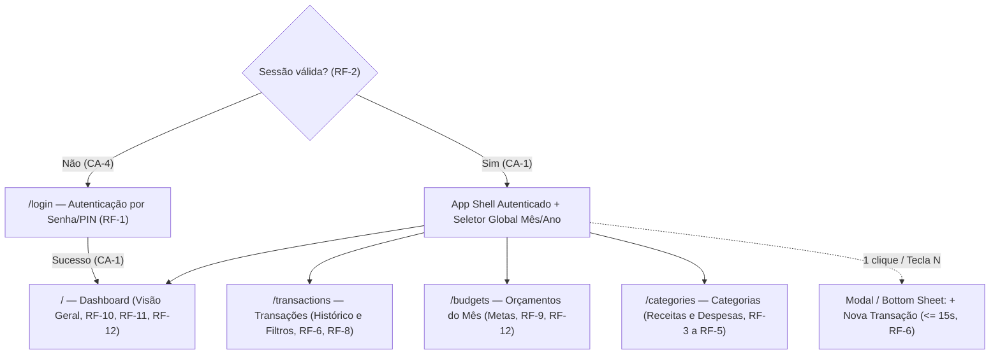

# Controle Financeiro Pessoal (MVP)

Status: entregue

Requisitos descrevem comportamento observável, não tarefas de código. Ao mudar um requisito, atualize esta spec **antes** do código.

## Problema e objetivo
<!-- product-owner: quem sofre, custo hoje, resultado e métricas (linha de base → alvo) -->

### Problema
Pessoas que buscam controlar suas finanças pessoais sofrem diariamente para registrar gastos no momento em que ocorrem e mensalmente para fechar o balanço entre o que ganharam e o que gastaram. Hoje, as alternativas impõem um custo alto de atrito ou privacidade:
1. **Planilhas manuais** são inviáveis de operar rapidamente pelo celular, gerando esquecimento de lançamentos e abandono do controle ao longo do mês.
2. **Aplicativos comerciais** costumam ser poluídos, exigem assinaturas recorrentes ou forçam a exposição de dados bancários sensíveis em servidores de terceiros.

Como consequência, o usuário perde a visibilidade do seu fluxo de caixa real durante o mês e só descobre que estourou o orçamento de categorias críticas (como alimentação, transporte ou lazer) quando o mês já fechou no vermelho.

### Objetivo
Entregar um Web App responsivo (PWA) de uso individual (*single-user*), rápido e privado, que permita ao usuário registrar receitas e despesas em segundos de qualquer dispositivo (computador ou celular), definir tetos mensais de gastos por categoria e acompanhar em tempo real a saúde do seu fluxo de caixa e o consumo do seu orçamento.

### Métricas de sucesso
| Métrica | Linha de base (hoje) | Alvo (MVP) |
|---|---|---|
| **Tempo para registrar uma transação** | ~3 min (abrir planilha no desktop e ajustar células) | **≤ 15 segundos** no celular ou computador |
| **Visibilidade de aderência ao orçamento** | Apuração tardia apenas no fechamento do mês | **100% das categorias orçadas** com barra de progresso e alerta visual (normal, atenção ≥ 80%, estourado > 100%) em tempo real |
| **Integridade do fluxo de caixa** | Lançamentos sem padronização ou esquecidos | **100% das transações** validadas com data, valor positivo, tipo e categoria associada |

## Escopo e fora de escopo
<!-- product-owner: histórias US-n em ordem de prioridade; o que NÃO será feito -->

### Escopo do MVP (Backlog priorizado por fatia vertical)

1. **US-1 — Autenticação single-user por senha/PIN:**
   Como titular do controle financeiro, quero acessar o aplicativo informando uma senha única / PIN configurada por variável de ambiente e manter minha sessão autenticada, para proteger meus dados financeiros contra acesso não autorizado sem a complexidade de cadastro multiusuário.

2. **US-2 — Gestão de categorias de receita e despesa:**
   Como usuário, quero contar com categorias essenciais pré-cadastradas e poder criar, editar ou arquivar categorias personalizadas (definindo nome, tipo receita/despesa e cor identificadora), para classificar minhas movimentações de acordo com a minha realidade financeira.

3. **US-3 — Lançamento e gestão de transações financeiras:**
   Como usuário, quero registrar, listar, filtrar (por mês/ano, tipo e categoria), editar e excluir transações de receita e despesa contendo valor, data, descrição e categoria, para manter meu histórico financeiro fiel e atualizado tanto no celular quanto no computador.

4. **US-4 — Orçamento mensal por categoria (metas de gastos):**
   Como usuário, quero definir, atualizar ou remover um valor limite de gasto mensal para cada categoria de despesa no mês/ano selecionado, para planejar meu custo de vida e estabelecer tetos claros de consumo.

5. **US-5 — Dashboard de resumo financeiro, fluxo de caixa e acompanhamento de metas:**
   Como usuário, quero visualizar um painel consolidado do mês/ano selecionado com os indicadores de resumo (total de receitas, total de despesas, saldo líquido do período e total orçado vs. realizado), comparativo gráfico de fluxo de caixa (receitas vs. despesas por categoria/período) e o progresso percentual de cada meta de orçamento com destaque visual para categorias em atenção (≥ 80%) ou estouradas (> 100%), para decidir imediatamente onde conter gastos antes do fim do mês.

### Fora de escopo (Não será feito no MVP)
Para maximizar o valor entregue por unidade de esforço e validar o núcleo do produto sem desperdício (YAGNI), ficam explicitamente **fora do MVP**:
- **SaaS multiusuário (cadastro público, recuperação de senha por e-mail, múltiplos tenants):** esforço elevado de gestão de identidade e isolamento sem valor para uso individual privado.
- **Gestão de faturas de cartão de crédito (fechamento, vencimento e limites):** alta complexidade contábil; no MVP, todas as despesas seguem o lançamento direto na data informada.
- **Despesas e receitas recorrentes ou parceladas automatizadas:** evita complexidade de jobs agendados e regras de alteração de séries futuras no primeiro ciclo.
- **Importação e exportação de arquivos bancários (OFX/CSV):** elimina o custo de manter parsers para múltiplos formatos de bancos antes de validar o uso diário.
- **Integração automática via Open Finance:** custo regulatório e dependência de provedores externos incompatíveis com uma solução leve e auto-hospedável.
- **Múltiplas moedas, carteira de investimentos (renda variável) e upload de comprovantes:** funcionalidades secundárias que não bloqueiam o controle de fluxo de caixa e orçamento mensal.

## Requisitos
<!-- requirements-analyst: cada item é uma afirmação testável, sem "rápido" ou "fácil" -->

### Requisitos Funcionais

- **RF-1 (US-1 — Login por credencial única):** O sistema deve autenticar o usuário validando a senha/PIN informada contra a credencial configurada via variável de ambiente (`APP_PASSWORD`), emitindo em caso de sucesso uma sessão autenticada via cookie `HttpOnly` assinado com validade de 7 dias.
- **RF-2 (US-1 — Proteção de rotas e logout):** O sistema deve exigir sessão autenticada válida em todas as páginas da aplicação (exceto `/login`) e em todos os endpoints da API (exceto `/api/auth/login` e `/api/health`), retornando `HTTP 401` na API ou redirecionando para `/login` na interface web quando ausente ou expirada, além de permitir encerrar a sessão (`logout`) invalidando o cookie imediatamente.
- **RF-3 (US-2 — Carga inicial de categorias):** Na inicialização sobre um banco de dados sem categorias registradas, o sistema deve criar de forma idempotente um conjunto inicial de categorias ativas de receita (`INCOME`: Salário, Rendimentos, Outras Receitas) e de despesa (`EXPENSE`: Alimentação, Moradia, Transporte, Saúde, Lazer, Outras Despesas), cada uma com nome, tipo e cor hexadecimal (`#RRGGBB`).
- **RF-4 (US-2 — Criação e edição de categorias):** O sistema deve permitir criar e editar categorias contendo `name` (obrigatório, 2 a 50 caracteres após remoção de espaços nas extremidades, único por `type` de forma case-insensitive), `type` (`INCOME` | `EXPENSE`) e `color` (formato hexadecimal `#RRGGBB` válido). Se a categoria já possuir transações ou orçamentos vinculados, seu `type` não pode ser alterado.
- **RF-5 (US-2 — Arquivamento, reativação e exclusão de categorias):** O sistema deve impedir a exclusão física de qualquer categoria que possua transações ou metas de orçamento vinculadas (retornando `HTTP 409 Conflict`), permitindo marcá-la como arquivada (`isArchived = true`) ou reativá-la (`isArchived = false`). Categorias arquivadas não devem ser listadas como opção para novas transações ou novos orçamentos, mas devem continuar visíveis no histórico e nos cálculos dos meses em que possuem lançamentos. Categorias sem vínculos podem ser excluídas fisicamente.
- **RF-6 (US-3 — CRUD de transações financeiras):** O sistema deve permitir criar, visualizar, editar e excluir transações financeiras contendo: `type` (`INCOME` | `EXPENSE`), `amountCents` (inteiro estritamente positivo `>= 1` e `<= 99999999999`, representando centavos de Real de `R$ 0,01` a `R$ 999.999.999,99`), `date` (data civil válida no formato ISO `YYYY-MM-DD`, sem deslocamento de fuso horário), `description` (texto obrigatório de 1 a 120 caracteres após trim) e `categoryId` obrigatório.
- **RF-7 (US-3 — Consistência entre transação e categoria):** O sistema deve rejeitar (`HTTP 400`/`422`) a criação ou edição de uma transação cujo `type` (`INCOME` | `EXPENSE`) seja diferente do `type` da categoria informada, ou cuja categoria não exista, ou cuja categoria esteja arquivada (`isArchived = true`), exceto na edição de uma transação que mantenha a mesma categoria arquivada já associada a ela anteriormente.
- **RF-8 (US-3 — Listagem paginada e filtragem de transações):** O sistema deve listar as transações filtradas obrigatoriamente por competência (`month` de 1 a 12 e `year` de 2000 a 2100) e opcionalmente por `type` (`INCOME` | `EXPENSE`), `categoryId` e termo de busca em `description` (case-insensitive), ordenadas por `date` decrescente e `createdAt` decrescente, com paginação (`page >= 1`, `pageSize` padrão 20 e máximo 100) retornando a lista de registros e os metadados `totalItems`, `totalPages`, `currentPage` e `pageSize`.
- **RF-9 (US-4 — Gestão de orçamento mensal por categoria de despesa):** O sistema deve permitir definir (criar ou atualizar para a chave única `categoryId + month + year`) e remover uma meta de gasto mensal contendo `categoryId`, `month` (1 a 12), `year` (2000 a 2100) e `limitCents` (inteiro estritamente positivo `>= 1`), restringindo o vínculo exclusivamente a categorias ativas do tipo `EXPENSE`.
- **RF-10 (US-5 — Indicadores consolidados do Dashboard):** Para o `month` e `year` selecionados, o sistema deve calcular e exibir:
  1. `totalIncomeCents`: soma de `amountCents` das transações `INCOME` do período (`0` se não houver);
  2. `totalExpenseCents`: soma de `amountCents` das transações `EXPENSE` do período (`0` se não houver);
  3. `netBalanceCents`: `totalIncomeCents - totalExpenseCents` (inteiro positivo, zero ou negativo);
  4. `totalBudgetedCents`: soma de `limitCents` dos orçamentos definidos para o período (`0` se não houver);
  5. `totalBudgetSpentCents`: soma de `amountCents` das transações `EXPENSE` pertencentes às categorias orçadas no período (`0` se não houver).
- **RF-11 (US-5 — Consolidação de fluxo de caixa e despesas por categoria):** Para o `month` e `year` selecionados, o sistema deve fornecer os dados agregados para visualização gráfica contendo o comparativo de entradas (`totalIncomeCents`) versus saídas (`totalExpenseCents`) e o agrupamento de transações por categoria contendo `categoryId`, `categoryName`, `categoryColor`, `type`, `totalAmountCents` e `sharePercentage` (`(totalAmountCents / totalDoTipoNoMes) * 100` com 2 casas decimais), ordenado do maior para o menor valor.
- **RF-12 (US-5 — Progresso de metas de orçamento e alertas visuais):** Para cada orçamento cadastrado no `month` e `year` selecionados, o sistema deve calcular o gasto realizado na categoria (`spentCents`), o saldo restante da meta (`remainingCents = limitCents - spentCents`), o percentual de execução `usagePercentage = round((spentCents / limitCents) * 100, 2)` e classificar o estado da meta em exatamente um dos três níveis:
  - `NORMAL`: quando `usagePercentage < 80.00`;
  - `WARNING` (Atenção): quando `80.00 <= usagePercentage <= 100.00`;
  - `EXCEEDED` (Estourado): quando `usagePercentage > 100.00`.

### Requisitos Não Funcionais

- **RNF-1 (Precisão monetária e representação em BRL):** Todos os valores financeiros devem ser armazenados no banco de dados, trafegados em payloads JSON e processados na camada de domínio exclusivamente como números inteiros representando centavos de Real (`centavos`), proibindo o uso de ponto flutuante binário para armazenamento monetário; na interface, todos os valores devem ser formatados segundo a convenção `pt-BR` na moeda `BRL` (`R$ 1.234,56`).
- **RNF-2 (Segurança de sessão e proteção contra força bruta):** A credencial `APP_PASSWORD` nunca deve ser exposta no código cliente nem em logs; o cookie de sessão deve conter as diretivas `HttpOnly`, `SameSite=Lax` (ou `Strict`) e `Secure` (em ambiente HTTPS); o endpoint de autenticação deve limitar tentativas malsucedidas a no máximo 5 requisições por IP a cada 15 minutos, rejeitando tentativas subsequentes na janela com `HTTP 429 Too Many Requests`.
- **RNF-3 (Desempenho Web e orçamento de bundle):** A aplicação web deve atingir no percentil 75 (p75): Largest Contentful Paint (LCP) ≤ 2,5 s, Interaction to Next Paint (INP) ≤ 200 ms e Cumulative Layout Shift (CLS) ≤ 0,1, mantendo o bundle JavaScript inicial por rota ≤ 170 KB (gzip).
- **RNF-4 (Desempenho de API e consultas indexadas):** Os endpoints de listagem de transações e agregação de dashboard devem apresentar latência p95 ≤ 200 ms para uma base de até 10.000 transações locais, utilizando índices no banco de dados para filtragem por período/categoria e executando zero queries N+1.
- **RNF-5 (Acessibilidade WCAG 2.2 AA e responsividade mobile-first):** Todas as telas devem atender ao padrão WCAG 2.2 nível AA, garantindo navegação completa via teclado (`Tab`, `Enter`, `Escape`), foco visível, contraste mínimo de 4,5:1 para textos normais e 3:1 para componentes gráficos, associação explícita de `<label>` e mensagens de erro via `aria-describedby`, suporte a `prefers-reduced-motion`, identificação dos alertas de orçamento (`NORMAL`, `WARNING`, `EXCEEDED`) por rótulo textual e ícone além da cor, e layout sem rolagem horizontal entre 320 px e 1920 px de largura.
- **RNF-6 (Privacidade e LGPD by design):** O sistema não deve transmitir dados financeiros ou pessoais para serviços externos de terceiros, e os logs de execução da aplicação não devem conter valores de senhas, tokens de sessão ou hashes de autenticação.

## Critérios de aceite
<!-- requirements-analyst: Dado/Quando/Então; todo RF tem ao menos um CA -->

- **CA-1 (RF-1):** **Dado** que o usuário não está autenticado e a variável `APP_PASSWORD` está configurada no servidor, **Quando** ele submeter o formulário de login com a senha exata configurada, **Então** o sistema deve responder com sucesso (`HTTP 200`), definir o cookie de sessão `HttpOnly` e redirecionar o usuário para o Dashboard.
- **CA-2 (RF-1):** **Dado** que o usuário está na tela de login, **Quando** ele submeter uma senha divergente de `APP_PASSWORD`, **Então** o sistema deve retornar `HTTP 401 Unauthorized`, não emitir cookie de sessão e exibir a mensagem `"Senha inválida"` mantendo o foco acessível no formulário.
- **CA-3 (RF-1, RNF-2):** **Dado** que um mesmo cliente realizou 5 tentativas de login com senha incorreta dentro de 15 minutos, **Quando** ele realizar a 6ª tentativa de login dentro dessa mesma janela, **Então** o sistema deve rejeitar a requisição com `HTTP 429 Too Many Requests` antes de processar a senha e informar o tempo restante para nova tentativa.
- **CA-4 (RF-2):** **Dado** que o usuário não possui cookie de sessão válido, **Quando** ele tentar acessar qualquer rota privada da interface (como Dashboard, Transações, Categorias ou Orçamentos) ou chamar um endpoint protegido da API, **Então** a interface deve redirecioná-lo para `/login` e a API deve responder `HTTP 401 Unauthorized`.
- **CA-5 (RF-2):** **Dado** que o usuário está autenticado em uma sessão ativa, **Quando** ele acionar a opção de sair (`Logout`), **Então** o sistema deve limpar/invalidar o cookie de sessão, redirecionar para `/login` e impedir que requisições subsequentes com a sessão encerrada acessem dados protegidos.
- **CA-6 (RF-3):** **Dado** um banco de dados recém-inicializado sem nenhuma categoria cadastrada, **Quando** a rotina de inicialização (*seed*) for executada uma ou mais vezes consecutivas, **Então** o sistema deve conter exatamente o conjunto padrão de categorias ativas (`INCOME` e `EXPENSE`) sem gerar duplicatas em execuções repetidas.
- **CA-7 (RF-4):** **Dado** que o usuário está autenticado, **Quando** ele criar uma categoria informando nome `"Educação"`, tipo `"EXPENSE"` e cor `"#2563EB"`, ou editar o nome e a cor de uma categoria existente com dados válidos, **Então** o sistema deve persistir a categoria e retorná-la com status `isArchived = false`.
- **CA-8 (RF-4):** **Dado** que já existe uma categoria do tipo `"EXPENSE"` chamada `"Alimentação"`, **Quando** o usuário tentar criar ou renomear outra categoria do mesmo tipo `"EXPENSE"` para `"alimentação"` (mesmo nome ignorando maiúsculas/minúsculas) ou informar um nome com menos de 2 caracteres ou cor fora do padrão `#RRGGBB`, **Então** o sistema deve rejeitar a operação (`HTTP 409` para duplicidade ou `HTTP 400`/`422` para validação) e exibir o erro correspondente.
- **CA-9 (RF-4):** **Dado** que uma categoria do tipo `"EXPENSE"` já possui ao menos uma transação ou orçamento vinculado, **Quando** o usuário tentar alterar o campo `type` dessa categoria para `"INCOME"`, **Então** o sistema deve rejeitar a alteração com `HTTP 409 Conflict` (ou `HTTP 422`) preservando o tipo original.
- **CA-10 (RF-5):** **Dado** que uma categoria possui ao menos uma transação financeira ou meta de orçamento vinculada a ela, **Quando** o usuário solicitar a exclusão física (`DELETE`) dessa categoria, **Então** o sistema deve bloquear a exclusão retornando `HTTP 409 Conflict` e instruir o usuário a arquivá-la.
- **CA-11 (RF-5):** **Dado** que uma categoria com transações no mês de outubro/2026 foi arquivada (`isArchived = true`), **Quando** o usuário abrir o seletor de categorias para criar uma nova transação ou consultar o histórico/dashboard de outubro/2026, **Então** a categoria arquivada não deve aparecer como opção no formulário de criação, mas deve continuar sendo exibida normalmente nas transações e gráficos de outubro/2026.
- **CA-12 (RF-5):** **Dado** que uma categoria personalizada não possui nenhuma transação nem orçamento vinculado, **Quando** o usuário solicitar sua exclusão física (`DELETE`), **Então** o sistema deve remover o registro permanentemente do banco de dados e retornar sucesso (`HTTP 200`/`204`).
- **CA-13 (RF-6, RNF-1):** **Dado** que o usuário está autenticado e seleciona uma categoria ativa do tipo `"EXPENSE"`, **Quando** ele registrar uma despesa no valor de `R$ 45,90` (`amountCents = 4590`), data `"2026-10-15"` e descrição `"Almoço executivo"`, **Então** o sistema deve persistir `amountCents = 4590` como inteiro, associar à data `"2026-10-15"` sem alteração de dia por fuso horário e exibir `R$ 45,90` na listagem.
- **CA-14 (RF-6):** **Dado** que o usuário está no formulário de transação, **Quando** ele tentar salvar uma transação com valor igual a `0` (`R$ 0,00`), valor negativo, data inválida ou descrição em branco, **Então** o sistema deve rejeitar a requisição com `HTTP 400`/`422`, não gravar o registro e destacar o campo inválido com mensagem acessível.
- **CA-15 (RF-7):** **Dado** que a categoria `"Salário"` é do tipo `"INCOME"` e a categoria `"Lazer Antigo"` está arquivada (`isArchived = true`), **Quando** o usuário tentar registrar uma nova transação do tipo `"EXPENSE"` vinculada à categoria `"Salário"` ou uma nova transação vinculada a `"Lazer Antigo"`, **Então** o sistema deve rejeitar a operação com `HTTP 400`/`422` informando a incompatibilidade de tipo ou o estado arquivado da categoria.
- **CA-16 (RF-8):** **Dado** que existem 25 transações em outubro/2026 (sendo 15 despesas da categoria `"Alimentação"`, 5 despesas de `"Transporte"` e 5 receitas de `"Salário"`) e 10 transações em setembro/2026, **Quando** o usuário filtrar a listagem por `month = 10`, `year = 2026`, `type = EXPENSE`, `categoryId = Alimentação` e `pageSize = 10` na `page = 1`, **Então** o sistema deve retornar 10 registros ordenados por data decrescente e os metadados `totalItems = 15`, `totalPages = 2`, `currentPage = 1` e `pageSize = 10`.
- **CA-17 (RF-8):** **Dado** que não existem transações registradas para o filtro selecionado (ex.: `month = 11`, `year = 2026`), **Quando** o usuário consultar a listagem de transações daquele período, **Então** o sistema deve retornar uma lista vazia (`totalItems = 0`, `totalPages = 0`) e a interface deve apresentar um estado vazio informativo com atalho para registrar uma nova transação.
- **CA-18 (RF-9):** **Dado** que `"Alimentação"` é uma categoria ativa do tipo `"EXPENSE"`, **Quando** o usuário definir um orçamento de `R$ 1.200,00` (`limitCents = 120000`) para `month = 10` e `year = 2026` e posteriormente atualizar esse mesmo orçamento para `R$ 1.500,00` (`limitCents = 150000`), **Então** o sistema deve manter apenas um registro de orçamento para `("Alimentação", 10, 2026)` com `limitCents = 150000`, permitindo também excluí-lo quando solicitado.
- **CA-19 (RF-9):** **Dado** que `"Salário"` é uma categoria do tipo `"INCOME"`, **Quando** o usuário tentar definir uma meta de orçamento mensal para `"Salário"` ou informar um `limitCents <= 0` para qualquer categoria, **Então** o sistema deve rejeitar a requisição com `HTTP 400`/`422` informando que apenas categorias de despesa ativas aceitam orçamento positivo.
- **CA-20 (RF-10, RNF-1):** **Dado** que em outubro/2026 existem receitas somando `R$ 8.000,00` (`800000` centavos), despesas em `"Alimentação"` somando `R$ 900,00` (`90000` centavos), despesas em `"Saúde"` (sem meta definida) somando `R$ 300,00` (`30000` centavos) e uma meta de orçamento para `"Alimentação"` de `R$ 1.000,00` (`100000` centavos), **Quando** o usuário visualizar o Dashboard de outubro/2026, **Então** o resumo deve exibir exatamente: Total de Receitas `R$ 8.000,00` (`800000`), Total de Despesas `R$ 1.200,00` (`120000`), Saldo Líquido `R$ 6.800,00` (`680000`), Total Orçado `R$ 1.000,00` (`100000`) e Total Realizado nas Categorias Orçadas `R$ 900,00` (`90000`).
- **CA-21 (RF-10, RF-11, RF-12):** **Dado** um mês/ano que não possui nenhuma transação e nenhuma meta de orçamento cadastrada, **Quando** o usuário selecionar esse período no Dashboard, **Então** todos os indicadores monetários do resumo devem exibir `R$ 0,00` (`0` centavos), sem erro de divisão por zero, e as seções de gráficos e metas devem exibir estados vazios claros orientando o primeiro cadastro.
- **CA-22 (RF-11):** **Dado** que em outubro/2026 o total de despesas é `R$ 1.000,00` (`100000` centavos), sendo `R$ 600,00` (`60000`) em `"Moradia"` e `R$ 400,00` (`40000`) em `"Alimentação"`, **Quando** o usuário consultar os gráficos de fluxo de caixa e distribuição por categoria do Dashboard, **Então** o sistema deve retornar `"Moradia"` com `60,00%` (`60000` centavos) e `"Alimentação"` com `40,00%` (`40000` centavos), preservando as cores configuradas de cada categoria.
- **CA-23 (RF-12, RNF-5):** **Dado** que a categoria `"Alimentação"` possui orçamento de `R$ 1.000,00` (`100000` centavos) em outubro/2026 e a soma das despesas nessa categoria no mês é `R$ 799,90` (`79990` centavos), **Quando** o progresso do orçamento for calculado, **Então** o sistema deve retornar `usagePercentage = 79.99`, `remainingCents = 20010` (`R$ 200,10`) e classificar o status como `NORMAL` (`< 80%`), exibindo barra de progresso e indicador textual/visual de estado normal.
- **CA-24 (RF-12, RNF-5):** **Dado** que a categoria `"Transporte"` possui orçamento de `R$ 500,00` (`50000` centavos) em outubro/2026, **Quando** a soma das despesas dessa categoria no mês atingir `R$ 400,00` (`40000` centavos, equivalente a `80,00%`) ou `R$ 500,00` (`50000` centavos, equivalente a `100,00%`), **Então** o sistema deve classificar o status como `WARNING` (Atenção) em ambos os limites inclusivos (`80,00%` e `100,00%`), exibindo alerta visual e textual de atenção.
- **CA-25 (RF-12, RNF-5):** **Dado** que a categoria `"Lazer"` possui orçamento de `R$ 300,00` (`30000` centavos) em outubro/2026 e a soma das despesas dessa categoria no mês atingir `R$ 300,03` (`30003` centavos, equivalente a `100,01%`) ou `R$ 450,00` (`45000` centavos, equivalente a `150,00%`), **Quando** o progresso do orçamento for calculado, **Então** o sistema deve retornar `remainingCents` negativo (`-3` ou `-15000`), `usagePercentage > 100.00` e classificar o status como `EXCEEDED` (Estourado), destacando visualmente e textualmente o excesso.

## Design
<!-- ux-designer: fluxos, telas e estados. ui-designer: tokens e componentes. Só referencie RF/CA por ID -->

### UX — Arquitetura de Informação, Fluxos, Telas e Estados

#### 1. Arquitetura de Informação e Navegação Responsiva

A aplicação organiza-se em **1 rota pública** (`/login`) e **4 rotas autenticadas principais** (`RF-1`, `RF-2`, `CA-4`, `CA-5`), compartilhando um cabeçalho contextual e um modal global de lançamento rápido.



##### 1.1. Seletor Global de Competência (Mês/Ano)
- **Presença:** Fixo no cabeçalho superior das visões `Dashboard`, `Transações` e `Orçamentos` (oculto em `Categorias`, cujo cadastro é atemporal, embora respeite vínculos históricos conforme `RF-5` e `CA-11`).
- **Sincronização de estado:** Refletido na URL (`?month=MM&year=YYYY`) para compartilhamento/reload sem perda de contexto; assume por padrão o mês e ano civis correntes na primeira visita.
- **Interação rápida:** Botões de passo `◀ Mês anterior` e `Próximo mês ▶` (alvos ≥ `44x44 px`), seletor direto de Mês (`Jan`–`Dez`) e Ano (`2000`–`2100`, `RF-8`, `RF-9`), além de um botão-pílula `"Mês atual"` exibido sempre que o usuário estiver navegando fora da competência corrente.

##### 1.2. Adaptação Responsiva (Mobile-First, `320px` a `1920px` — `RNF-5`)
| Dimensão / Aspecto | Mobile (`320px` – `767px`) | Desktop (`>= 768px`) |
|---|---|---|
| **Navegação Primária** | **Bottom Navigation Bar** fixa na base com 5 slots: `Início`, `Transações`, Botão Central `+` (`Nova Transação`), `Orçamentos`, `Categorias`. | **Sidebar lateral esquerda** fixa (`240px`) com links de navegação + botão primário `+ Nova Transação` no topo e ação `Sair` no rodapé. |
| **Cabeçalho (Top Bar)** | Compacto (`56px` de altura): Título da tela atual à esquerda, Seletor Global `Mês/Ano` centralizado e botão ícone `Sair` (`CA-5`) à direita. | Barra superior limpa com título da visão, Seletor Global `Mês/Ano` e indicador de atalho `+ Nova Transação (N)`. |
| **Gatilho de Lançamento Rápido (≤ 15s)** | Botão central destacado na Bottom Bar (`48x48 px`, sempre ao alcance do polegar) que abre um **Bottom Sheet / Drawer** modal. | Botão primário no topo da Sidebar/Header ou tecla de atalho `N` (quando o foco não está em um input) que abre um **Dialog Modal** centralizado. |
| **Listagens e Tabelas** | Listas em **Cards empilhados** de coluna única (descrição, categoria com badge de cor, data e valor alinhado à direita) para eliminar rolagem horizontal (`RNF-5`). | **Tabela estruturada** com colunas para Data, Descrição, Categoria, Tipo, Valor e Ações rápidas (`Editar`, `Excluir`). |

#### 2. Fluxos de Usuário e Redução de Atrito

##### 2.1. Fluxo de Autenticação e Proteção de Sessão (`RF-1`, `RF-2`, `RNF-2`, `CA-1` a `CA-5`)
- **Tarefa principal:** Desbloquear o aplicativo com o mínimo de digitação ou encerrar a sessão com segurança.
- **Redução de atrito:** Ao carregar `/login`, o campo `Senha / PIN` recebe foco automático (`autofocus`). Inclui botão alternador `"Mostrar senha"` (`aria-pressed`) para evitar erros de digitação no celular e submissão direta via tecla `Enter`.

##### 2.2. Fluxo de Lançamento Rápido de Transação em ≤ 15 Segundos (`RF-6`, `RF-7`, `RNF-1`, `CA-11`, `CA-13` a `CA-15`)
- **Decisões de UX para velocidade (Smart Defaults):**
  1. **Contexto preservado:** O formulário abre sobre a tela atual.
  2. **Valores pré-preenchidos:** `Tipo` inicia em `Despesa` (`EXPENSE`); `Data` inicia preenchida com a data civil de hoje (`YYYY-MM-DD`, `CA-13`) com atalhos `"Hoje"` e `"Ontem"`; `Categoria` lista exclusivamente categorias ativas (`isArchived = false`) compatíveis com o `type` selecionado (`RF-5`, `RF-7`, `CA-11`, `CA-15`), renderizadas como chips clicáveis e pré-selecionando a primeira categoria ativa.
  3. **Ordem de campos:** `1. Tipo (Segmented Control)` → `2. Valor em R$ (foco automático + teclado numérico)` → `3. Categoria (Chips de 1 toque)` → `4. Descrição (texto curto)` → `5. Data (já preenchida)`.
  4. **Entrada monetária (`RNF-1`):** `inputmode="numeric"` formatando centavos em tempo real (`4590` → `R$ 45,90`, `amountCents = 4590`, `CA-13`).

##### 2.3. Fluxo de Análise no Dashboard (`RF-10`, `RF-11`, `RF-12`, `CA-20` a `CA-25`)
- **Ordenação inteligente:**
  - **Progresso do Orçamento Mensal (`RF-12`):** ordena os cartões por criticidade decrescente (`EXCEEDED` → `WARNING` → `NORMAL`, desempatando pelo maior `usagePercentage`).
  - **Distribuição por Categoria (`RF-11`, `CA-22`):** ordena da maior para a menor participação (`sharePercentage`), permitindo clicar em qualquer categoria para filtrar `/transactions` (`RF-8`, `CA-16`).

##### 2.4. Fluxo de Gestão de Orçamento Mensal (`RF-9`, `RF-12`, `CA-18`, `CA-19`)
- A tela `/budgets` lista todas as categorias ativas do tipo `EXPENSE` (`CA-19`) divididas em:
  1. **Categorias com meta definida no mês:** barra de progresso, status (`NORMAL`, `WARNING`, `EXCEEDED`), `Gasto atual vs. Meta`, `Saldo restante / Excesso` e ações `"Editar meta"` (`CA-18`) e `"Remover meta"`.
  2. **Categorias de despesa sem meta no mês:** exibe quanto já foi gasto na categoria no mês atual e botão direto `"Definir meta"`.

##### 2.5. Fluxo de Gestão de Categorias e Arquivamento Seguro (`RF-3`, `RF-4`, `RF-5`, `CA-6` a `CA-12`)
- Ao editar categoria com vínculos, o campo `Tipo` fica bloqueado (`CA-9`).
- Ao tentar excluir categoria com vínculos (`CA-10`, `HTTP 409 Conflict`), oferece ação guiada `"Arquivar categoria"` (`isArchived = true`), preservando o histórico (`CA-11`).

#### 3. Estados de Interface e Microcopy (`pt-BR`)
- **Login (`/login`):** Inicial com foco automático; Carregando (`"Verificando..."`, `aria-busy="true"`); Erro `401` (`"Senha inválida"`, `CA-2`); Erro `429` (`"Muitas tentativas de acesso. Por segurança, aguarde [X] minutos antes de tentar novamente."`, `CA-3`).
- **Dashboard (`/`):** Skeleton com dimensões fixas (`CLS ≤ 0,1`); Vazio (`R$ 0,00` nos KPIs sem `NaN` + CTAs `"+ Registrar primeira transação"` e `"Definir metas do mês"`, `CA-21`); Parcial (`totalExpenseCents` separado de `totalBudgetSpentCents`, `CA-20`).
- **Transações (`/transactions`):** Vazio no período (`"Nenhuma transação em [Mês/Ano]"`, `CA-17`) vs. Vazio por filtro (`"Nenhuma transação encontrada para os filtros selecionados."` + `"Limpar filtros"`).
- **Orçamentos (`/budgets`):** Validação inline para limite `<= 0` (`"Informe um limite mensal maior que R$ 0,00 para uma categoria de despesa ativa."`, `CA-19`).
- **Categorias (`/categories`):** Seed inicial carregado (`CA-6`); duplicidade `409` (`"Já existe uma categoria de [Despesa/Receita] com este nome."`, `CA-8`); conflito de exclusão `409` com botão `"Arquivar categoria"` (`CA-10`).

#### 4. Usabilidade e Acessibilidade WCAG 2.2 AA (`RNF-5`)
- **Semântica Multimodal de Orçamento (`RF-12`, `CA-23` a `CA-25`):**
  - `NORMAL` (`< 80%`): Ícone `CheckCircle` (`✓`), Badge `"Dentro da meta"`, texto `"Restam R$ X,XX (Y,YY% utilizado)"`, `role="progressbar"`.
  - `WARNING` (`80% <= uso <= 100%`): Ícone `AlertTriangle` (`⚠`), Badge `"Atenção"`, texto `"Restam R$ X,XX (Y,YY% utilizado — próximo ao limite)"`, `role="progressbar"`.
  - `EXCEEDED` (`> 100%`): Ícone `AlertOctagon` (`!`), Badge `"Estourado"`, texto `"Excedido em R$ X,XX (Y,YY% utilizado)"`, `role="progressbar"`.
- **Teclado, Foco e Leitores de Tela:** Anel `:focus-visible` (`2px`), fechamento de modais com `Escape`, *Focus Trap* em modais, `<label for>` explícito em todos os campos, `aria-describedby` para erros, lista estruturada acessível acompanhando os gráficos (`RF-11`, `CA-22`), alvos de toque mínimos de `44x44 px` e suporte a `prefers-reduced-motion`.

---

### UI — Identidade Visual, Design Tokens e Componentes

#### 1. Direção Visual e Princípios de Interface
- **Estética ("Clean Financial Ledger"):** Interface financeira contemporânea de alta precisão, superfícies neutras com bordas sutis (`1px solid`) e uso semântico de cor.
- **Legibilidade Numérica (`RNF-1`, `RNF-3`):** Uso obrigatório de `font-variant-numeric: tabular-nums` (`.tabular-nums`) em todos os valores monetários (`BRL`), percentuais, datas civis (`DD/MM/AAAA`) e contadores.

#### 2. Paleta de Cores Semântica e Contraste WCAG 2.2 AA (`RNF-5`)
| Token Semântico | Modo Claro (`:root`) | Modo Escuro (`.dark`) | Uso nos Requisitos |
|---|---|---|---|
| `--color-bg-canvas` | `#F8FAFC` (Slate 50) | `#090D16` (Slate 950) | Fundo geral das rotas (`RF-2`, `RNF-5`) |
| `--color-surface` | `#FFFFFF` (White) | `#111827` (Slate 900) | Cards, tabelas, modais e drawers (`RF-6`, `RF-10`) |
| `--color-surface-muted` | `#F1F5F9` (Slate 100) | `#1E293B` (Slate 800) | Cabeçalhos de tabela, hover, trilhas de barras (`RF-8`, `RF-12`) |
| `--color-text-primary` | `#0F172A` (17,85:1) | `#F8FAFC` (15,80:1) | Títulos, valores principais, descrições (`RNF-1`, `RNF-5`) |
| `--color-text-secondary` | `#475569` (7,58:1) | `#CBD5E1` (10,95:1) | Rótulos (`<label>`), metadados, datas (`RNF-5`) |
| `--color-text-muted` | `#64748B` (4,76:1) | `#94A3B8` (5,96:1) | Textos auxiliares, categorias arquivadas (`RF-5`, `CA-11`) |
| `--color-border-subtle` | `#E2E8F0` | `#1E293B` | Divisores de linhas e contornos de cards |
| `--color-border-control` | `#64748B` (≥ 3:1 UI) | `#64748B` (≥ 3:1 UI) | Bordas de `<input>`, `<select>` e botões secundários (`RNF-5`) |
| `--color-primary` | `#1D4ED8` (6,70:1) | `#2563EB` (5,17:1) | CTA primário ("Nova Transação", "Entrar") (`RF-1`, `RF-6`) |
| `--color-focus-ring` | `#2563EB` | `#60A5FA` | Anel `:focus-visible` (`2px solid`, `outline-offset: 2px` — `RNF-5`) |
| `--color-income-text` / `--color-status-normal-text` | `#047857` (5,48:1) | `#34D399` (8,96:1) | Valores `INCOME`, saldo positivo e status `NORMAL < 80%` (`CA-20`, `CA-23`) |
| `--color-income-fill` / `--color-status-normal-fill` | `#059669` | `#10B981` | Barras `INCOME` e barra de progresso `NORMAL` (`RF-11`, `RF-12`) |
| `--color-income-bg` / `--color-status-normal-bg` | `#ECFDF5` | `#064E3B` | Superfície de `StatusBadge` (`NORMAL`) |
| `--color-status-warning-text` | `#B45309` (5,02:1) | `#FBBF24` (10,42:1) | Texto e ícone do alerta `WARNING` (`80%..100%` — `RF-12`, `CA-24`) |
| `--color-status-warning-fill` | `#D97706` | `#F59E0B` | Barra de progresso em estado `WARNING` (`CA-24`) |
| `--color-status-warning-bg` | `#FFFBEB` | `#451A03` | Superfície de `StatusBadge` (`WARNING`) |
| `--color-expense-text` / `--color-status-exceeded-text` | `#BE123C` (6,34:1) | `#FB7185` (6,45:1) | Valores `EXPENSE`, saldo negativo, status `EXCEEDED > 100%` e erros (`CA-25`) |
| `--color-expense-fill` / `--color-status-exceeded-fill` | `#E11D48` | `#F43F5E` | Barras `EXPENSE`, barra `EXCEEDED` e botões destrutivos (`CA-12`, `CA-25`) |
| `--color-expense-bg` / `--color-status-exceeded-bg` | `#FFF1F2` | `#4C0519` | Superfície de `StatusBadge` (`EXCEEDED`) e alertas de erro |

- **Cores do Seed Inicial de Categorias (`RF-3`, `CA-6`):**
  - `INCOME`: Salário `#059669`, Rendimentos `#0D9488`, Outras Receitas `#0284C7`.
  - `EXPENSE`: Alimentação `#EA580C`, Moradia `#2563EB`, Transporte `#7C3AED`, Saúde `#E11D48`, Lazer `#D97706`, Outras Despesas `#475569`.

#### 3. Design Tokens e Catálogo de Componentes
- **Tipografia e Espaçamento:** `--font-sans` (`Inter`, `system-ui`) e `--font-mono` (`JetBrains Mono`, `monospace`); escala modular `--text-xs` (`12px`) a `--text-3xl` (`30px`); espaçamento base `4px/8px`; raios `--radius-sm` (`6px`) a `--radius-full` (`9999px`); transições `120ms–180ms` desativadas sob `prefers-reduced-motion: reduce`.
- **Componentes Reutilizáveis:**
  1. `MonthYearPicker`: Seletor global de competência (`1..12`, `2000..2100`) com botões de passo e atalho `"Mês atual"`.
  2. `SummaryCard`: Cards de KPIs do Dashboard (`income`, `expense`, `balance`, `budgetSummary`) com `.tabular-nums` e skeleton de altura fixa.
  3. `BudgetProgressCard`: Card de meta mensal por categoria com `CategoryBadge`, `StatusBadge` (`NORMAL`, `WARNING`, `EXCEEDED`), barra `role="progressbar"` e saldo/excesso.
  4. `CashFlowChart`: Comparativo visual leve em SVG/CSS nativo de entradas vs. saídas (`RNF-3`, zero bibliotecas pesadas de gráfico).
  5. `CategoryBreakdownList`: Lista ordenada decrescentemente por participação (`sharePercentage%`) com barra proporcional colorida (`categoryColor`).
  6. `TransactionModal` / `TransactionDrawer`: Formulário rápido de lançamento/edição com máscara monetária em centavos, chips de categorias ativas por tipo e data civil `YYYY-MM-DD`.
  7. `TransactionTable` / `TransactionList`: Tabela semântica em desktop e lista de cards em mobile, com busca, filtros por tipo/categoria e paginação (`RF-8`).
  8. `CategoryBadge` e `StatusBadge`: Badges semânticos acessíveis com cor, ícone e texto.

## Solução técnica e tarefas
<!-- tech-lead: decisões, contrato de API, riscos. Tarefas em fatias verticais; marque [x] ao concluir -->

### 1. Arquitetura e Stack (Versões Fixadas)

Adotamos um **Monolito Modular Full-Stack em TypeScript** organizado por *features* verticais com **contrato único compartilhado** (`src/shared/contracts/` via Zod), onde um único processo Node.js serve a API REST (`/api/*`) e os ativos estáticos da SPA/PWA em produção (ADR-0001).

| Camada / Ferramenta | Pacote / Tecnologia | Versão Fixada | Justificativa Técnica |
|---|---|---|---|
| **Runtime** | Node.js LTS | `>=22.12.0` | Estabilidade LTS, suporte nativo a `crypto`, `fetch`, `node:sqlite` e alta performance em container único. |
| **Linguagem** | `typescript` | `5.8.2` | Tipagem estrita (`strict: true`, `noUncheckedIndexedAccess: true`) ponta a ponta. |
| **Backend HTTP** | `fastify` + `@fastify/cookie` + `@fastify/static` | `5.2.1` / `11.0.2` / `8.1.0` | Baixo overhead (`RNF-4`), ciclo de hooks limpo para autenticação/rate-limit e entrega estática da SPA. |
| **Banco de Dados** | SQLite em modo WAL (`node:sqlite` / `better-sqlite3`) | Nativo / `11.8.1` | Banco embarcado síncrono de latência sub-milissegundo (`RNF-4`), zero custo de rede e persistência simples em volume Docker/Fly.io/Render/Railway (`RNF-6`). |
| **Validação e Contratos** | `zod` | `3.24.2` | Fonte única da verdade (*parse, don't validate*) entre payloads de API, queries e formulários React. |
| **Frontend UI** | `react` + `react-dom` | `19.0.0` | Renderização declarativa enxuta, mantendo o bundle inicial bem abaixo de `170 KB` gzip (`RNF-3`). |
| **Bundler / Dev Server** | `vite` + `@vitejs/plugin-react` | `6.2.0` / `4.3.4` | Build otimizado com code-splitting, proxy local `/api` e suporte a manifesto PWA. |
| **Qualidade (`check`)** | `@biomejs/biome`, `knip`, `jscpd`, `vitest` | `1.9.4` / `5.46.0` / `4.0.5` / `3.0.8` | Portão único determinístico: formatação, lint, typecheck, código morto, duplicação e testes automatizados. |

#### Estrutura de Diretórios por Feature
```text
personal-finance/
├── docs/
│   ├── adr/
│   │   ├── 0001-stack-and-monolith-architecture.md
│   │   └── 0002-integer-cents-and-civil-dates.md
│   └── specs/
│       └── personal-finance-mvp.md
├── src/
│   ├── shared/                 # Fonte única da verdade (Backend + Frontend)
│   │   ├── contracts/          # Schemas Zod e tipos inferidos (auth, categories, transactions, budgets, dashboard)
│   │   └── domain/             # Funções puras de domínio (moeda em centavos, datas civis YYYY-MM-DD, status de orçamento)
│   ├── server/                 # Aplicação Backend (Fastify + SQLite)
│   │   ├── config/             # Parse de variáveis de ambiente (APP_PASSWORD, SESSION_SECRET, DATABASE_PATH, PORT)
│   │   ├── db/                 # Conexão SQLite (WAL + FK), migrations SQL e seed idempotente (RF-3)
│   │   ├── modules/
│   │   │   ├── auth/           # Login, Logout, Sessão HttpOnly HMAC e Rate Limiter por IP (RF-1, RF-2, RNF-2)
│   │   │   ├── categories/     # CRUD, proteção de vínculo e arquivamento (RF-3, RF-4, RF-5)
│   │   │   ├── transactions/   # CRUD, validação de categoria e listagem paginada (RF-6, RF-7, RF-8)
│   │   │   ├── budgets/        # Upsert mensal por categoria de despesa e exclusão (RF-9)
│   │   │   └── dashboard/      # Agregações SQL de resumo, fluxo de caixa e metas (RF-10, RF-11, RF-12)
│   │   └── app.ts              # Instância Fastify testável via inject()
│   └── client/                 # Aplicação Frontend (React + CSS Tokens semânticos)
│       ├── styles/             # Design tokens CSS (Light/Dark, WCAG 2.2 AA, .tabular-nums)
│       ├── components/         # AppShell, MonthYearPicker, SummaryCard, BudgetProgressCard, CashFlowChart, etc.
│       ├── features/           # Telas e hooks por feature (auth, dashboard, transactions, budgets, categories)
│       └── main.tsx            # Ponto de entrada da SPA
├── tests/                      # Testes unitários, de integração de API/DB e de componentes
├── Dockerfile                  # Build multi-stage enxuto pronto para cloud (Fly.io / Render / Railway)
├── package.json                # Script único `npm run check`
└── AGENTS.md                   # Guia enxuto do repositório
```

### 2. Modelo de Dados Relacional e Índices (`RNF-1`, `RNF-4`)

O SQLite é inicializado com `PRAGMA journal_mode = WAL; PRAGMA synchronous = NORMAL; PRAGMA foreign_keys = ON; PRAGMA busy_timeout = 5000;`.

- **Tabela `categories` (`RF-3`, `RF-4`, `RF-5`):** `id` (TEXT PK), `name` (TEXT), `name_normalized` (TEXT — `trim().toLocaleLowerCase('pt-BR')`), `type` (`'INCOME' | 'EXPENSE'`), `color` (`#RRGGBB`), `is_archived` (`0 | 1`), `created_at`, `updated_at`. Índices: `UNIQUE (type, name_normalized)` e `(type, is_archived)`.
- **Tabela `transactions` (`RF-6`, `RF-7`, `RF-8`, `RNF-1`, `RNF-4`):** `id` (TEXT PK), `type` (`'INCOME' | 'EXPENSE'`), `amount_cents` (INTEGER `1..99999999999`), `date` (TEXT `YYYY-MM-DD`), `year` (INTEGER `2000..2100`), `month` (INTEGER `1..12`), `description` (TEXT `1..120`), `category_id` (FK `categories(id) ON DELETE RESTRICT`), `created_at`, `updated_at`. Índices: `(year, month, date DESC, created_at DESC)`, `(year, month, type, category_id)` e `(category_id)`.
- **Tabela `budgets` (`RF-9`, `RF-12`, `RNF-1`, `RNF-4`):** `id` (TEXT PK), `category_id` (FK `categories(id) ON DELETE RESTRICT`), `year` (INTEGER `2000..2100`), `month` (INTEGER `1..12`), `limit_cents` (INTEGER `1..99999999999`), `created_at`, `updated_at`, `UNIQUE (category_id, year, month)`. Índice: `(year, month, category_id)`.

### 3. Contratos de API REST (`/api/*`)

- **Erro padrão:** `{ "error": { "code": "...", "message": "...", "details"?: {}, "retryAfterSeconds"?: number } }`
- **Autenticação (`RF-1`, `RF-2`, `RNF-2`):**
  - `GET /api/health` → `200 { status: "ok", timestamp }`
  - `POST /api/auth/login` → valida `password` via `timingSafeEqual`, define cookie `pf_session` (`HttpOnly`, `SameSite=Lax`, 7 dias), rate limit de 5 falhas / 15 min por IP (`429` com `retryAfterSeconds`).
  - `POST /api/auth/logout` → limpa cookie `pf_session`.
  - `GET /api/auth/session` → `200 { authenticated: true }` ou `401`.
- **Categorias (`RF-3`, `RF-4`, `RF-5`):**
  - `GET /api/categories?type=&includeArchived=` → `{ items: CategoryDto[] }` (com `hasLinkedRecords`).
  - `POST /api/categories` → `201 CategoryDto` (`409` para nome duplicado no tipo, `400/422` para validação).
  - `PATCH /api/categories/:id` → `200 CategoryDto` (`409` se tentar mudar `type` com vínculo ou duplicar nome).
  - `DELETE /api/categories/:id` → `204` se sem vínculos, `409 Conflict` se houver transações ou orçamentos vinculados.
- **Transações (`RF-6`, `RF-7`, `RF-8`):**
  - `GET /api/transactions?month=&year=&type=&categoryId=&search=&page=&pageSize=` → `{ items: TransactionDto[], meta: { totalItems, totalPages, currentPage, pageSize } }`.
  - `POST /api/transactions` → `201 TransactionDto` (`400/422` se categoria inexistente, de outro tipo ou arquivada).
  - `PUT /api/transactions/:id` → `200 TransactionDto` (permite manter a mesma categoria arquivada já vinculada à transação).
  - `DELETE /api/transactions/:id` → `204`.
- **Orçamentos (`RF-9`, `RF-12`):**
  - `GET /api/budgets?month=&year=` → `{ month, year, items: BudgetProgressDto[], unbudgetedExpenseCategories: UnbudgetedCategoryDto[] }`.
  - `PUT /api/budgets` → upsert por `(categoryId, month, year)` apenas para categorias `EXPENSE` ativas com `limitCents >= 1`.
  - `DELETE /api/budgets/:id` → `204`.
- **Dashboard (`RF-10`, `RF-11`, `RF-12`):**
  - `GET /api/dashboard?month=&year=` → `{ month, year, summary: { totalIncomeCents, totalExpenseCents, netBalanceCents, totalBudgetedCents, totalBudgetSpentCents }, cashFlow: { totalIncomeCents, totalExpenseCents }, categoryBreakdown: CategoryShareDto[], budgetProgress: BudgetProgressDto[] }`.

### 4. Plano de Tarefas em Fatias Verticais

- [x] **T-1 (Scaffold, Contratos Compartilhados, Domínio Puro e Portão `check`)** — dono: `tech-lead` — Criar estrutura do repositório, configuração TypeScript estrita, Biome, Knip, jscpd, Vitest, hook `.git/hooks/pre-commit`, schemas Zod compartilhados (`src/shared/contracts/`) e funções puras de domínio (`src/shared/domain/`: formatação/parse de centavos `BRL`, validação de data civil `YYYY-MM-DD` e cálculo de progresso/status de orçamento `NORMAL` / `WARNING` / `EXCEEDED` cobrindo a lógica matemática de `CA-13`, `CA-23`, `CA-24`, `CA-25`). Critério de pronto: `npm run check` verde.
- [x] **T-2 (Camada de Persistência SQLite, Migrations, Índices e Seed Idempotente — `CA-6`, `RNF-4`)** — dono: `database-engineer` (depende de: `T-1`) — Implementar conexão SQLite em modo WAL com `foreign_keys = ON`, criação automática de tabelas e índices (`categories`, `transactions`, `budgets`) e rotina de *seed* idempotente das 9 categorias iniciais (`INCOME` e `EXPENSE`) com testes de integração em banco isolado validando `CA-6` e os índices de `RNF-4`. Critério de pronto: `npm run check` verde.
- [x] **T-3 (Backend: Autenticação Single-User, Sessão HttpOnly e Rate Limiting — `CA-1`, `CA-2`, `CA-3`, `CA-4`, `CA-5`, `RNF-2`, `RNF-6`)** — dono: `backend-senior` (depende de: `T-2`) — Implementar validação de variáveis de ambiente (`APP_PASSWORD`, `SESSION_SECRET`), endpoints `/api/health`, `/api/auth/login`, `/api/auth/logout`, `/api/auth/session`, comparação em tempo constante (`timingSafeEqual`), cookie assinado `HttpOnly` de 7 dias, hook de proteção de rotas privadas e rate limiter por IP (5 falhas / 15 min retornando `429` com `retryAfterSeconds`). Critério de pronto: testes de integração cobrindo `CA-1` a `CA-5` e `npm run check` verde.
- [x] **T-4 (Backend: Gestão de Categorias e Regras de Vínculo/Arquivamento — `CA-7`, `CA-8`, `CA-9`, `CA-10`, `CA-11`, `CA-12`)** — dono: `backend-senior` (depende de: `T-3`) — Implementar rotas `GET/POST/PATCH/DELETE /api/categories` com unicidade case-insensitive Unicode (`name_normalized` em `pt-BR`), bloqueio de alteração de `type` quando houver vínculo (`409`), bloqueio de exclusão física com vínculo (`409`), exclusão física sem vínculo (`204`) e arquivamento/reativação (`isArchived`). Critério de pronto: testes de integração cobrindo `CA-7` a `CA-12` e `npm run check` verde.
- [x] **T-5 (Backend: CRUD de Transações, Validação Cruzada de Categoria e Listagem Paginada — `CA-11`, `CA-13`, `CA-14`, `CA-15`, `CA-16`, `CA-17`, `RNF-1`, `RNF-4`)** — dono: `backend-senior` (depende de: `T-4`) — Implementar rotas `GET/POST/PUT/DELETE /api/transactions` garantindo persistência em centavos (`amountCents`), data civil exata (`YYYY-MM-DD` sem shift de fuso), validação de compatibilidade de `type` e `isArchived` da categoria (incluindo exceção de edição mantendo a mesma categoria arquivada de `RF-7`) e listagem filtrada/paginada sem N+1. Critério de pronto: testes de integração cobrindo `CA-11` e `CA-13` a `CA-17` e `npm run check` verde.
- [x] **T-6 (Backend: Orçamentos Mensais e Agregações do Dashboard — `CA-18`, `CA-19`, `CA-20`, `CA-21`, `CA-22`, `CA-23`, `CA-24`, `CA-25`, `RNF-4`)** — dono: `backend-senior` (depende de: `T-5`) — Implementar rotas `GET/PUT/DELETE /api/budgets` (upsert por `categoryId + month + year` restrito a categorias `EXPENSE` ativas) e `GET /api/dashboard` (indicadores `totalIncomeCents`, `totalExpenseCents`, `netBalanceCents`, `totalBudgetedCents`, `totalBudgetSpentCents`, distribuição percentual com proteção contra divisão por zero e progresso de metas ordenado por criticidade). Critério de pronto: testes de integração cobrindo `CA-18` a `CA-25` e `npm run check` verde.
- [x] **T-7 (Frontend: Design System Tokens, App Shell Responsivo, Seletor Global Mês/Ano e Fluxo de Login — `CA-1`, `CA-2`, `CA-3`, `CA-4`, `CA-5`, `RNF-3`, `RNF-5`)** — dono: `frontend-senior` (depende de: `T-3`) — Implementar tokens CSS (Light/Dark, WCAG 2.2 AA, `.tabular-nums`), cliente HTTP tipado, tela `/login` (autofocus, mostrar senha, tratamento acessível de `401` e `429`), guarda de rotas privadas, `AppShell` responsivo (Sidebar no desktop, Bottom Bar no mobile) e `MonthYearPicker` sincronizado via URL (`?month=&year=`). Critério de pronto: testes de interface cobrindo `CA-1` a `CA-5` e `npm run check` verde.
- [x] **T-8 (Frontend: Gestão de Categorias e Modal Global de Lançamento Rápido + Histórico de Transações — `CA-6` a `CA-17`, `RNF-1`, `RNF-5`)** — dono: `frontend-senior` (depende de: `T-5`, `T-7`) — Implementar tela `/categories`, `TransactionModal` global acionável em 1 clique ou tecla `N` (máscara monetária em centavos `inputmode="numeric"`, chips de categorias ativas, atalhos Hoje/Ontem) e tela `/transactions` (filtros por tipo/categoria/busca, tabela desktop, cards mobile e paginação). Critério de pronto: testes cobrindo `CA-6` a `CA-17` e `npm run check` verde.
- [x] **T-9 (Frontend: Gestão de Orçamentos Mensais e Dashboard Consolidado — `CA-18` a `CA-25`, `RNF-3`, `RNF-5`)** — dono: `frontend-senior` (depende de: `T-6`, `T-8`) — Implementar tela `/budgets` e tela `/` Dashboard (`SummaryCard` x4, `CashFlowChart` em SVG/CSS nativo leve sem libs pesadas, `CategoryBreakdownList` clicável para filtrar transações e `BudgetProgressCard` com semântica multimodal `NORMAL`/`WARNING`/`EXCEEDED` por cor + ícone + badge textual + `role="progressbar"`). Critério de pronto: testes cobrindo `CA-18` a `CA-25`, bundle inicial `<= 170 KB` gzip e `npm run check` verde.
- [x] **T-10 (DevOps: Containerização Multi-Stage, CI GitHub Actions e Configuração Cloud — `RNF-2`, `RNF-3`, `RNF-6`)** — dono: `devops-engineer` (depende de: `T-1`) — Criar `Dockerfile` multi-stage enxuto (usuário não-root, volume persistente `/data` para o SQLite WAL, healthcheck em `/api/health`), `.dockerignore`, `docker-compose.yml`, `.env.example`, configuração de deploy (`fly.toml` / `render.yaml`) e workflow `.github/workflows/ci.yml` executando `npm run check`. Critério de pronto: build/check validados e `npm run check` verde.
- [x] **T-11 (QA, Segurança e Revisão Final Ponta a Ponta — `CA-1` a `CA-25`, `RNF-1` a `RNF-6`)** — dono: `qa-senior` + `security-engineer` + `code-reviewer` (depende de: `T-9`, `T-10`) — Validar matriz completa de rastreabilidade `CA-1` a `CA-25`, teste de performance `RNF-4` (consulta paginada e dashboard `< 200 ms` com base de 10.000 transações), auditoria de segurança (`RNF-2`, `RNF-6`) e revisão final de código limpo (`npm run check` verde).

## Riscos e questões abertas
- **Q-1 (Resolvida por padrão — Data civil vs. Timezone):** Para evitar que transações lançadas em `YYYY-MM-DD` sofram mudança de dia/mês devido à conversão UTC ↔ `America/Sao_Paulo`, o campo `date` de transações é tratado estritamente como data civil (`YYYY-MM-DD`) (ver ADR-0002).
- **Q-2 (Resolvida por padrão — Despesas sem orçamento no resumo):** No Dashboard (`RF-10`), podem existir despesas em categorias para as quais o usuário não cadastrou meta no mês. Por padrão, o resumo separa `totalExpenseCents` (todas as despesas do mês) de `totalBudgetSpentCents` (despesas de categorias com orçamento ativo no mês).
- **R-1 (Unicidade Case-Insensitive com Acentuação no SQLite — `CA-8`):** O `COLLATE NOCASE` nativo do SQLite compara apenas caracteres ASCII (`A-Z`), falhando em `"Alimentação"` vs `"alimentação"`. **Mitigação:** persistir a coluna `name_normalized` gerada na aplicação com `name.trim().toLocaleLowerCase('pt-BR')` sob índice `UNIQUE (type, name_normalized)`.
- **R-2 (Persistência em Deploy Cloud Efêmero):** Containers em PaaS (Fly.io, Render, Railway) possuem sistema de arquivos efêmero fora de volumes montados. **Mitigação:** parametrizar `DATABASE_PATH` (ex.: `/data/finance.db`) apontando para volume persistente montado no container e documentar o backup simples do arquivo `.db`.
- **R-3 (Plano de Rollback):** As migrations SQL no MVP são estritamente aditivas (`CREATE TABLE/INDEX IF NOT EXISTS`). Em caso de regressão em deploy, o rollback consiste em reverter a imagem do container para a release anterior mantendo o volume SQLite intacto.
